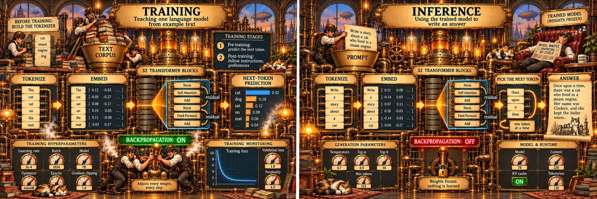

# tiny-llm-in-rust: a small language model, built from scratch to learn how LLMs work

[](https://github.com/jlinoff/tiny-llm-in-rust/releases)
[](https://github.com/jlinoff/tiny-llm-in-rust/actions/workflows/main.yaml)

This project builds every piece of a GPT-style (generative pre-trained
transformer) large language model, or LLM, by hand: small enough to read
and to run on a laptop, so a beginner can watch training and inference
happen instead of taking them on faith. Terms are defined in
[PLAN.md](PLAN.md)'s Terms section.



*The dials show a typical 7-billion-parameter model; this project's models
are far smaller (1.35M and 7.4M parameters, 4 and 8 blocks), but the machine
is the same. The illustration was generated by ChatGPT from prompts
written with Claude; no copyright is claimed.*

- **a tokenizer** (byte-pair encoding, plain Python) that turns text into
  token IDs and back;
- **a transformer** (Rust, no machine-learning framework): its own matrices,
  automatic differentiation, training loop, optimizer, fine-tuning
  (including LoRA (low-rank adaptation), which trains a small add-on
  instead of every weight), text generation with a key–value (KV) cache so each new
  token reuses earlier work, and a probe for looking inside;
- **the same inference code running a real open-weight model** (one whose
  trained weights are published), Hugging Face's SmolLM-135M and its
  13-times-larger sibling SmolLM-1.7B, their predictions checked against
  Hugging Face's own implementation.

Models are trained on [TinyStories](https://arxiv.org/abs/2305.07759), short
stories written for small models. What it gets you:

| | Size | Training on an M4 Mac | Writes |
|---|---|---|---|
| Small model, `config.toml` | 1.35M parameters | about 3 minutes | grammatical, but loses track of its characters |
| Full model, `config-full.toml` | 7.4M parameters | about 19 hours | coherent stories (validation loss 1.45) |

Fine-tuned on requests such as "write a story with the words fish, pond and
name", the full model makes the requested words 3.5 times as likely as when
it's given someone else's request: "Once upon a time, there was a little
fish named Fin. Fin lived in a big pond with his fish friends…"

## PLAN.md: the real documentation

[PLAN.md](PLAN.md) is where everything is explained: what each step does
and why, the terms (all defined before use), every measurement, including
the predictions that turned out wrong, and what production models add.
At nearly 4,000 lines it is very nearly a corpus of its own. Start with its
table of contents; the directory READMEs (`tokenizer/`, `transformer/`, …)
document each program.

## Requirements

- Rust 1.87 or later (`cargo`), Python 3.8 or later (standard library only),
  GNU make, and `curl` for the downloads. On macOS, Apple's `make` is too
  old: `brew install make` and use `gmake`.
- On macOS, Apple's Accelerate library is used for large matrix products
  automatically, about 2.7 times faster per training step.

## Train a small model and run it

Each `make` target runs one step and every step it needs first (downloading
the 19 MB TinyStories validation file, learning the tokenizer, encoding the
text, building the model):

```
make train                     # tokenize, encode, build, train: a few minutes
make generate PROMPT='Once upon a time'
make finetune evaluate         # teach it to answer requests, then measure how well
make chat PROMPT='Write a story with the words frog, bell and egg.'
make probe                     # look inside: which heads copy, what each block predicts
make help                      # every target, and every setting with what it does and its value
```

`config.toml` holds every setting, with comments. Change a section and only
the steps that depend on it rerun.

The full run uses the 2.2 GB TinyStories training file and the 7.4M model
(about a day; `make full-check` first tries the whole flow with very few
steps, in half an hour):

```
caffeinate -i gmake full-train   # caffeinate keeps a Mac awake
gmake full-finetune full-evaluate full-chat full-probe
```

## Run a real open-weight model

SmolLM-135M is a 135M-parameter Llama-style model published by Hugging Face.
Download it with Hugging Face's tool, then run it with this project's code:

```
mkdir hugging_face && cd hugging_face
pipenv install huggingface-hub transformers torch    # the last two only for the check
pipenv run hf download HuggingFaceTB/SmolLM-135M --local-dir models/SmolLM-135M
cd ..
make llama PROMPT='Once upon a time'                 # about 80 tokens per second on an M4
```

To check it against Hugging Face's own implementation (token IDs,
probabilities at every position, greedy text):

```
(cd hugging_face && pipenv run python3 ../tools/llama_reference.py models/SmolLM-135M -o models/SmolLM-135M/reference.json)
make llama-check
```

The probabilities agree to about 0.00007, the difference 32-bit
floating-point (f32) arithmetic makes when two programs add in different
orders, and the greedy text (always taking the most likely token) is
identical. Keep `hugging_face/models/` out of git: the weights are 513 MB.

**Larger models.** The same code, unchanged, runs SmolLM-1.7B, 13 times the
size: about 9 tokens per second on an M4, noticeably better stories, and the
same match with Hugging Face. Its weights come as two files, which need
merging into one first. PLAN.md gives the steps in
[Trying a new model](PLAN.md#trying-a-new-model-smollm-17b-step-by-step),
and the limits in [How far could this go?](PLAN.md#how-far-could-this-go):
memory caps a 32 GB Mac at about 4 billion parameters in 32-bit floats,
and the loader accepts only models it implements exactly, so other families
such as Qwen need code first.

## What's where

| Directory | What it holds |
|---|---|
| `tokenizer/` | `mini_bpe.py`: learning a tokenizer, encoding, decoding |
| `chat/` | `make_chat.py`: fine-tuning conversations made from the stories |
| `transformer/` | the model: build, train, finetune, generate, evaluate, probe, llama |
| `attention/` | self-attention on its own, on toy inputs, up to an induction head |
| `word2vec/` | word vectors, the historical precursor |
| `tools/` | helpers: PLAN.md's table of contents, the Hugging Face reference, experiments, continuous integration (CI)'s smoke test |

## Checks

```
make test          # everything below: a minute or two after the first build
make test-rust     # Rust unit tests: transformer, attention, word2vec
make test-python   # Python unit tests: mini_bpe.py, make_chat.py
make smoke         # the whole flow on a dozen short stories, in seconds
make lint          # formatting, clippy, pylint, PLAN.md's links, acronyms defined at first use, every setting in make help
```

What the tests guard, beyond each piece's own behavior:

- **gradients**: the whole model's, and LoRA's, match finite differences,
  so backpropagation is right;
- **training as a whole**: a fixed seed on a small fixture corpus must
  reproduce recorded losses, so a change that quietly alters training (a
  learning-rate or batching slip) fails a test instead of just training
  worse;
- **Python and Rust agree**: both tokenizers must reproduce the same
  fixtures (`transformer/tests/data`), written by `mini_bpe.py`;
- **honest fine-tuning data**: every request names words its story really
  contains, and evaluation stories are never trained on.

Every push and pull request runs the same checks in
`.github/workflows/main.yaml`, on Linux and on macOS (there with
Accelerate).

## License

MIT: see [LICENSE](LICENSE). This is meant for learning; use it freely.

## Acknowledgments

Built by Joe in collaboration with **Claude**, Anthropic's AI model (Claude
Opus 5.5): over many conversations, Claude wrote most of the code and of
PLAN.md, ran the experiments it could in its own workspace, and Joe directed
the project, asked the questions that shaped it, ran the long trainings on
his Mac, and reviewed every change. Commits made together carry a
`Co-Authored-By: Claude` line.

Built on others' work: the TinyStories dataset (Eldan and Li, 2023),
SmolLM-135M (Hugging Face, 2024), and Andrej Karpathy's nanoGPT and his
"Let's build GPT" lectures, the closest existing match to this project.
The papers behind each idea are in PLAN.md's bibliography.
